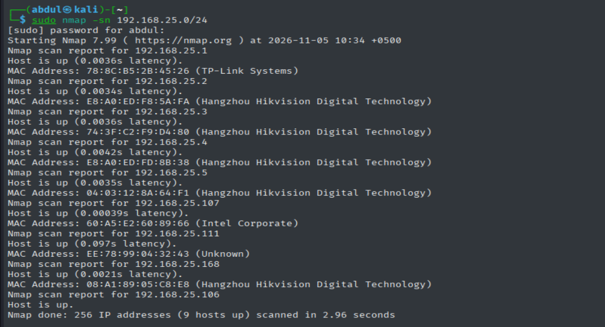

# 🔍 Task 1 — Network Reconnaissance and Open Port Scanning

**Elevate Labs | Cyber Security Internship**

## 📌 Overview

This project demonstrates practical network reconnaissance using **Nmap** and basic packet analysis using **Wireshark**.

The assessment focuses on discovering active network devices, identifying open TCP ports, detecting running services, understanding potential security risks, and examining TCP SYN scanning at the packet level.

## 🎯 Objectives

- Identify the local network subnet and connected devices.
- Perform host discovery using Nmap.
- Conduct TCP SYN port scanning.
- Identify open ports and running network services.
- Analyze potential security risks associated with exposed services.
- Capture and examine TCP packets using Wireshark.
- Document findings and recommend appropriate security controls.

## 🛠️ Tools and Environment

| Component | Details |
|---|---|
| Operating System | Kali Linux |
| Network Scanner | Nmap 7.99 |
| Packet Analyzer | Wireshark |
| Network Interface | eth0 |
| Network Subnet | 192.168.25.0/24 |
| Default Gateway | 192.168.25.1 |
| Test Environment | Local Network and Loopback Interface |

## 1. Understanding Nmap Scan Techniques

Nmap supports multiple techniques for network reconnaissance and service identification.

| Technique | Option | Description |
|---|---|---|
| Host Discovery | `-sn` | Identifies responsive hosts without port scanning |
| TCP SYN Scan | `-sS` | Discovers TCP port states using SYN packets |
| TCP Connect Scan | `-sT` | Establishes complete TCP connections |
| UDP Scan | `-sU` | Examines UDP port states |
| Service Detection | `-sV` | Attempts to identify running services and versions |
| OS Detection | `-O` | Attempts to identify the target operating system |

**Techniques implemented:** Host Discovery, TCP SYN Scanning, and Service Detection.

## 2. Practical Implementation

### 2.1 Network Identification

The first step was to identify the Kali Linux network configuration.

```bash
ip -br addr
ip route
```

**Observed Configuration:**

| Parameter | Value |
|---|---|
| Interface | eth0 |
| IP Address | 192.168.25.106 |
| Network | 192.168.25.0/24 |
| Gateway | 192.168.25.1 |

The results confirmed that the scanning machine was connected to the local network.

**Evidence:** `screenshots/01-network-information.png`

### 2.2 Host Discovery

Host discovery was performed using:

```bash
sudo nmap -sn 192.168.25.0/24
```

The `-sn` option identifies responsive devices without performing a port scan.

**Results:**

| Metric | Value |
|---|---|
| Addresses Scanned | 256 |
| Responsive Hosts | 9 |
| Scan Duration | 2.96 seconds |

The discovered devices included a TP-Link router, Hikvision-associated network devices, and additional local endpoints.

**Evidence:**

### 2.3 TCP SYN Port Scanning

A TCP SYN scan was performed against the local router.

```bash
sudo nmap -sS --open \
-oN tcp_syn_scan.txt \
192.168.25.1
```

**Results:**

| Port | State | Initial Service |
|---|---|---|
| 22/TCP | Open | SSH |
| 53/TCP | Open | DNS (port-based identification) |
| 80/TCP | Open | HTTP |
| 1900/TCP | Open | UPnP-related |

The scan identified **4 open TCP ports**. The remaining 996 ports in Nmap's default 1,000-port selection were reported as filtered.

**Evidence:** `screenshots/03-tcp-syn-scan.png`

### 2.4 Service and Version Detection

Service detection was performed to obtain more information about the discovered ports.

```bash
sudo nmap -sV -p 22,53,80,1900 \
-oN router_service_scan.txt \
192.168.25.1
```

**Results:**

| Port | Service | Detected Information |
|---|---|---|
| 22/TCP | SSH | OpenSSH 6.6.0 |
| 53/TCP | tcpwrapped | Service not positively identified |
| 80/TCP | HTTP | TP-LINK router HTTP configuration |
| 1900/TCP | UPnP-related | TP-LINK router upnpd |

The service scan provided additional information about the router's exposed applications.

Service banners and version fingerprints are not sufficient to confirm a software vulnerability.

**Evidence:** `screenshots/04-service-detection.png`

### 2.5 Additional Network Device Scanning

A targeted service scan was performed against five Hikvision-associated network devices.

```bash
sudo nmap -sS -sV --open \
-p 21,22,23,53,80,443,554,8000,8080 \
-oN device_service_scan.txt \
192.168.25.2 192.168.25.3 \
192.168.25.4 192.168.25.5 \
192.168.25.168
```

**Results:**

| Device | Open TCP Ports |
|---|---|
| 192.168.25.2 | 80, 554, 8000 |
| 192.168.25.3 | 80, 443, 554, 8000 |
| 192.168.25.4 | 80, 554, 8000 |
| 192.168.25.5 | 80, 554, 8000 |
| 192.168.25.168 | 80, 554, 8000 |

**Observations:**

- Five devices responded to the targeted scan.
- Sixteen open TCP port instances were identified.
- HTTP (80), RTSP (554), and camera-control (8000) services were detected across all five devices.
- HTTPS (443) was detected on one device.
- Nmap produced an inconsistent RTSP fingerprint on one device, demonstrating a limitation of automated service identification.

**Evidence:** `results/device_service_scan.txt`

## 3. Wireshark — TCP SYN Packet Analysis

### 3.1 Objective

To observe the TCP packet exchange generated during an Nmap SYN scan and understand how Nmap determines whether a TCP port is open.

A controlled experiment was performed using the Kali Linux loopback interface (`127.0.0.1`).

### 3.2 Start a Local HTTP Service

A temporary HTTP server was started on TCP port 8080.

```bash
python3 -m http.server 8080 --bind 127.0.0.1
```

This created a local listening service for the scanning experiment.

### 3.3 Capture Network Traffic

Wireshark was opened, and the loopback interface (`lo`) was selected for packet capture.

The following display filter was applied:

```text
tcp.port == 8080
```

This restricted the displayed traffic to TCP packets associated with port 8080.

### 3.4 Generate TCP SYN Traffic

An Nmap SYN scan was executed against the local HTTP server.

```bash
sudo nmap -sS -Pn -p 8080 127.0.0.1
```

The command targeted a known local listening port and generated TCP SYN scanning traffic.

### 3.5 TCP Packet Analysis

The experiment was designed to demonstrate the following packet exchange:

| Sequence | TCP Flags | Explanation |
|---|---|---|
| 1 | SYN | Nmap sends a connection initiation request |
| 2 | SYN, ACK | The listening service acknowledges the SYN |
| 3 | RST | The connection attempt is reset without completing a normal TCP handshake |

The packet sequence illustrates how TCP SYN scanning identifies an open port without normally establishing a complete connection.

**Wireshark Display Filters:**

SYN packets:

```text
tcp.flags.syn == 1 && tcp.flags.ack == 0
```

SYN/ACK packets:

```text
tcp.flags.syn == 1 && tcp.flags.ack == 1
```

RST packets:

```text
tcp.flags.reset == 1
```

**Evidence:**

- `screenshots/06-wireshark-syn-analysis.png`
- `results/syn-scan-capture.pcapng`

The packet capture should be reviewed to confirm the observed flags before making packet-specific conclusions.

## 4. Security Risk Assessment

Open ports are not automatically vulnerabilities. However, unnecessary or improperly configured services can increase the network attack surface.

| Port | Service | Potential Security Risk | Recommendation |
|---|---|---|---|
| 22 | SSH | Unauthorized remote administration | Restrict access and strengthen authentication |
| 53 | Unidentified | Unknown service exposure | Verify service and access controls |
| 80 | HTTP | Unencrypted administrative communication | Prefer HTTPS and restrict management |
| 1900 | UPnP-related | Unnecessary service exposure | Disable if not required |
| 443 | HTTPS | Potential web interface vulnerabilities | Maintain firmware and secure authentication |
| 554 | RTSP | Unauthorized video-stream access | Require authentication and restrict access |
| 8000 | Camera Control | Unauthorized device management | Allow access only from trusted systems |

### Recommended Security Improvements

1. **Service Hardening:** Disable unused network services and unnecessary administrative interfaces.
2. **Access Control:** Restrict management services to trusted devices and administrators.
3. **Firmware Updates:** Keep routers and network devices updated with supported security patches.
4. **Authentication Security:** Use strong, unique passwords and additional authentication controls where supported.
5. **Network Segmentation:** Separate CCTV and IoT devices from general-purpose endpoints where practical.
6. **Firewall Configuration:** Restrict unnecessary inbound and outbound connections.
7. **Continuous Monitoring:** Periodically review exposed services and investigate unexpected changes.

## 5. Evidence and Project Structure

```text
Task-1-Network-Port-Scanning/
│
├── README.md
│
├── results/
│   ├── tcp_syn_scan.txt
│   ├── router_service_scan.txt
│   ├── device_service_scan.txt
│   └── syn-scan-capture.pcapng
│
└── screenshots/
    ├── 01-network-information.png
    ├── 02-host-discovery.png
    ├── 03-tcp-syn-scan.png
    ├── 04-service-detection.png
    ├── 05-cctv-device-scan.png
    └── 06-wireshark-syn-analysis.png
```

*The structure represents the intended organization. File entries should be retained only where the corresponding evidence has been saved and uploaded.*

## 6. Key Learning Outcomes

This task provided hands-on experience in:

- Identifying network interfaces and local IP ranges.
- Discovering responsive devices using Nmap.
- Performing TCP SYN scans to identify open ports.
- Detecting running services and interpreting service fingerprints.
- Understanding differences between common Nmap scanning techniques.
- Capturing and examining TCP packets using Wireshark.
- Evaluating potential security risks associated with exposed services.
- Documenting technical findings and recommending security controls.

## 7. Conclusion

This task demonstrated the use of Nmap for network reconnaissance and Wireshark for understanding TCP scanning behavior.

The network discovery scan identified **9 responsive hosts**. Further assessment identified **4 open TCP ports on the router** and **16 open TCP port instances across five additional network devices**.

The practical exercise reinforced the importance of service identification, secure network configuration, access restrictions, and packet-level analysis.

The assessment was limited to reconnaissance and security exposure analysis. No exploitation or confirmed vulnerability testing was performed.

---

**Intern:** Abdul Moiz  
**Organization:** Elevate Labs  
**Task:** 01 — Scan Your Local Network for Open Ports  
**Date:** November 5, 2026

*Security testing should only be performed on personally owned systems or networks where explicit authorization has been granted.*
