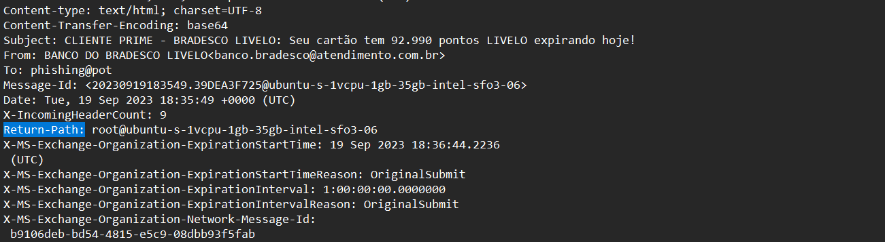
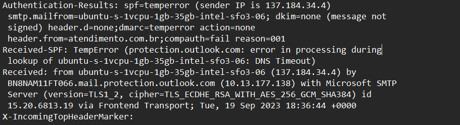
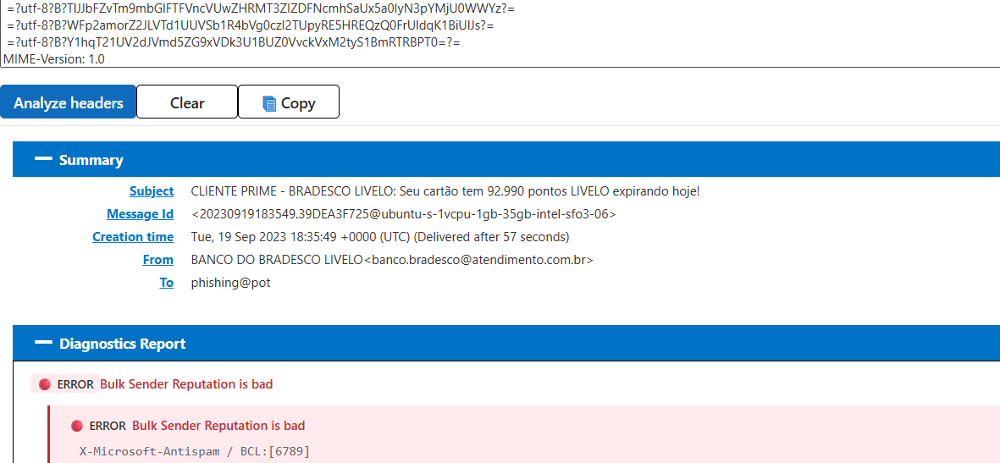
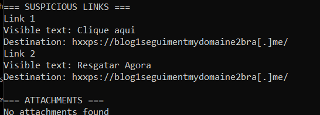
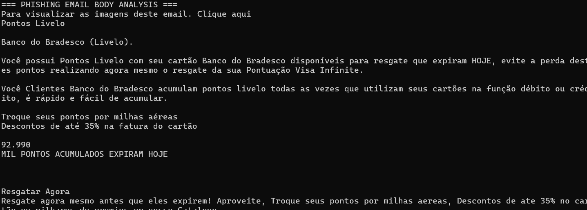

# Task 2 — Phishing Email Analysis

**Elevate Labs | Cyber Security Internship**

## 1. Project Overview

This project investigates a publicly available phishing email sample impersonating **Banco Bradesco / Livelo**, a Brazilian banking and rewards service.

The objective was to analyze the email's sender information, authentication results, routing headers, embedded URLs, attachments, and social-engineering techniques to identify phishing indicators.

The investigation was performed using Microsoft Message Header Analyzer, Python, Windows PowerShell, and manual email-content analysis.

**Final Classification:** Phishing — Brand Impersonation / Reward Redemption Lure

---

## 2. Objective

- Examine a suspicious email and identify possible sender impersonation.
- Analyze email headers and authentication mechanisms (SPF, DKIM, and DMARC).
- Investigate the originating IP address and email delivery path.
- Extract embedded URLs without visiting suspicious websites.
- Check for potentially malicious attachments.
- Identify urgency, deceptive messaging, and grammatical errors.
- Document technical evidence and provide a final security assessment.

---

## 3. Tools and Environment

| Tool | Purpose |
|---|---|
| Windows 11 / PowerShell | Local investigation environment |
| Python 3.11 | Email parsing, Base64 decoding, and URL extraction |
| Microsoft Message Header Analyzer | Email header and routing analysis |
| Notepad | Inspection of raw email headers |
| GitHub | Documentation and evidence storage |

**Sample format:** `.eml`

**Sample filename:** `sample-1.eml`

**Sample date:** September 19, 2023

The email was analyzed offline. Suspicious URLs were not opened.

---

## 4. Investigation Methodology

### 4.1 Obtaining the Phishing Email Sample

A publicly available phishing email sample was downloaded in `.eml` format.

The original message contained email headers and an HTML message body encoded using Base64.

The sample impersonated Banco Bradesco / Livelo and claimed that the recipient had reward points expiring soon.

### 4.2 Sender Address Examination

The following sender information was extracted from the original email.

| Field | Observed Value |
|---|---|
| Display Name | BANCO DO BRADESCO LIVELO |
| Sender Address | `banco.bradesco@atendimento.com.br` |
| Return-Path | `root@ubuntu-s-1vcpu-1gb-35gb-intel-sfo3-06` |
| Recipient | `phishing@pot` |
| Subject | CLIENTE PRIME - BRADESCO LIVELO: Seu cartão tem 92.990 pontos LIVELO expirando hoje! |

**Analysis:**

The display name impersonates Banco Bradesco / Livelo, while the sender domain `atendimento.com.br` does not visibly identify the claimed financial institution.

The Return-Path references a Linux server hostname rather than the displayed sender address.

These inconsistencies raise concerns about sender authenticity. They do not independently establish technical email spoofing.

**Evidence:**

---

### 4.3 Email Authentication Analysis

The original email headers were inspected for SPF, DKIM, DMARC, and Microsoft composite authentication results.

| Authentication Mechanism | Observed Result | Interpretation |
|---|---|---|
| SPF | `temperror` | Temporary DNS lookup failure; authentication could not be conclusively evaluated |
| DKIM | `none` | No DKIM signature was present |
| DMARC | `temperror` | Temporary error; no definitive DMARC pass/fail conclusion |
| Composite Authentication | `fail` | Microsoft's composite authentication assessment failed |

**Additional observations:**

- Originating IP: `137.184.34.4`
- Sending software: Postfix
- Sending hostname: `ubuntu-s-1vcpu-1gb-35gb-intel-sfo3-06`

**Analysis:**

The absence of DKIM signing, temporary SPF/DMARC errors, and failed composite authentication reduce confidence in the sender's authenticity.

SPF and DMARC temporary errors should not be incorrectly classified as definitive authentication failures.

**Evidence:**

---

### 4.4 Email Header Analysis

The complete email headers were submitted to **Microsoft Message Header Analyzer**.

The tool provided information about the message's routing path, delivery timing, sender reputation, and antispam headers.

**Key findings:**

| Indicator | Result |
|---|---|
| Originating IP | `137.184.34.4` |
| Sending MTA | Postfix |
| Bulk Complaint Level (BCL) | 9 |
| Spam Confidence Level (SCL) | 5 |
| Delivery time | Approximately 57 seconds |
| Header diagnostic | Bulk Sender Reputation is bad |

**Analysis:**

The BCL value of 9 indicates a highly unfavorable bulk-sender reputation assessment.

The SCL value of 5 indicates that Microsoft classified the message as likely spam.

These results strengthen suspicion but are not standalone proof of phishing.

**Evidence:**

---

### 4.5 Suspicious URL and Attachment Analysis

The email body used the following MIME configuration:

- Content-Type: `text/html`
- Charset: `UTF-8`
- Content-Transfer-Encoding: `base64`

Python's built-in `email` and `html.parser` modules were used to decode the message body and extract hyperlinks.

The HTML content was parsed locally without executing scripts or opening external URLs.

**Extracted links:**

| Link | Visible Text | Destination |
|---|---|---|
| 1 | Clique aqui | `hxxps://blog1seguimentmydomaine2bra[.]me/` |
| 2 | Resgatar Agora | `hxxps://blog1seguimentmydomaine2bra[.]me/` |

Both hyperlinks lead to the same destination.

The destination domain does not visibly correspond to the bank or rewards service being impersonated.

**Attachment analysis:**

The Python parser identified no MIME attachments in the sample.

**Assessment:**

The embedded URLs are suspicious because they direct the recipient away from the claimed organization's apparent identity.

The investigation did not establish whether the destination hosted credential-harvesting content or malware.

**Evidence:**

---

### 4.6 Urgency and Social Engineering Analysis

The message uses reward-based persuasion and time pressure to encourage the recipient to click a link.

**Example 1:**

> Seu cartão tem 92.990 pontos LIVELO expirando hoje!

**English translation:**

Your card has 92,990 LIVELO points expiring today!

**Example 2:**

> Resgate agora mesmo antes que eles expirem!

**English translation:**

Redeem them right now before they expire!

**Identified techniques:**

- **Brand impersonation:** Pretending to represent Banco Bradesco / Livelo.
- **Urgency:** Claiming reward points will expire today.
- **Reward incentive:** Offering redemption of accumulated points.
- **Call-to-action manipulation:** Encouraging the recipient to click a redemption link.

No explicit threat of account suspension or legal consequences was identified.

---

### 4.7 Spelling and Grammar Analysis

The Base64-encoded HTML body was decoded locally using Python.

The extracted message contained multiple language and formatting problems.

| Original Text | Observation |
|---|---|
| `Banco do Bradesco` | Unnatural presentation of the bank's name |
| `Você Clientes Banco do Bradesco` | Grammatically incorrect sentence construction |
| `milhas aereas` | Missing accent: `aéreas` |
| `milhares de premios` | Missing accent: `prêmios` |
| `nosso Catalogo` | Missing accent and inconsistent capitalization |
| `Descontos de ate 35%` | Missing accent: `até` |

The content also uses inconsistent capitalization and awkward promotional language.

These issues are supporting indicators rather than definitive evidence of phishing.

**Evidence:**

---

## 5. Summary of Phishing Indicators

| # | Indicator | Finding |
|---|---|---|
| 1 | Brand impersonation | Claims to represent Banco Bradesco / Livelo |
| 2 | Suspicious sender domain | `atendimento.com.br` does not visibly match the claimed brand |
| 3 | Return-Path inconsistency | Return-Path references a Linux server hostname |
| 4 | Authentication concerns | SPF/DMARC temporary errors, no DKIM, composite authentication failure |
| 5 | Poor sender reputation | BCL 9 and SCL 5 |
| 6 | Suspicious embedded links | Two links point to an unrelated-looking domain |
| 7 | Urgency tactic | Claims reward points expire today |
| 8 | Reward-based social engineering | Encourages immediate points redemption |
| 9 | Language errors | Grammatical mistakes and missing Portuguese accents |

**Attachments:** No MIME attachments identified.

---

## 6. Final Security Assessment

**Classification: Phishing**

**Attack type:** Brand Impersonation / Reward Redemption Lure

**Suspected objective:** Induce the recipient to visit an external website by presenting a time-sensitive reward redemption opportunity.

The email impersonates Banco Bradesco / Livelo and uses urgency, reward incentives, and misleading sender identity to encourage interaction.

The technical investigation identified sender inconsistencies, inconclusive or missing authentication evidence, poor sender reputation, and suspicious embedded links.

The message body further supports the phishing assessment through grammatical errors and time-sensitive promotional claims.

**Limitations:**

- The destination website was not visited.
- Credential theft or malware delivery was not directly verified.
- The originating IP address was identified from the email headers, but ownership and reputation were not independently investigated.
- Authentication temporary errors do not establish definitive SPF or DMARC failures.

Based on the combined evidence, the message is assessed as a phishing attempt.

---

## 7. Recommended Security Measures

1. Avoid clicking links in unsolicited reward or banking emails.
2. Verify financial notifications through official websites or applications opened independently.
3. Examine sender addresses and linked domains before interacting.
4. Report suspicious messages to the organization's security team or email provider.
5. Use email security controls, including SPF, DKIM, DMARC, and antiphishing filtering.
6. Block or investigate suspicious indicators according to organizational security policy.
7. Provide security-awareness training on urgency-based social engineering.

---

## 8. Evidence Files

| Screenshot | Description |
|---|---|
| `01-email-sender.png` | Sender address, subject, and Return-Path |
| `02-email-authentication.png` | SPF, DKIM, DMARC, and sending server information |
| `03-header-analyzer.png` | Microsoft Message Header Analyzer results |
| `04-suspicious-links.png` | Python URL extraction and attachment analysis |
| `05-email-body-analysis.png` | Decoded email body and language indicators |

All screenshots were collected during the investigation.

---

## 9. Skills Demonstrated

- Phishing email triage
- Email header analysis
- SPF, DKIM, and DMARC interpretation
- SMTP routing investigation
- Suspicious URL identification
- Python-based email parsing
- MIME and Base64 decoding
- Social engineering analysis
- Evidence collection and technical reporting

---

## 10. Conclusion

This investigation demonstrated how a phishing email can combine brand impersonation, reward-based persuasion, urgency, and suspicious hyperlinks to influence recipient behavior.

By correlating email headers, authentication results, antispam indicators, URL destinations, and message content, the sample was classified as a phishing attempt.

The task reinforced practical SOC analyst skills in phishing identification, evidence-based investigation, and security reporting.

---

**Internship:** Elevate Labs — Cyber Security Internship  
**Task:** 2 — Phishing Email Analysis  
**Author:** Abdul Moiz  
**Repository:** [Elevate Labs Cybersecurity Internship](https://github.com/cyberabdulmoiz/Elevate-Labs-Cybersecurity-Internship)
